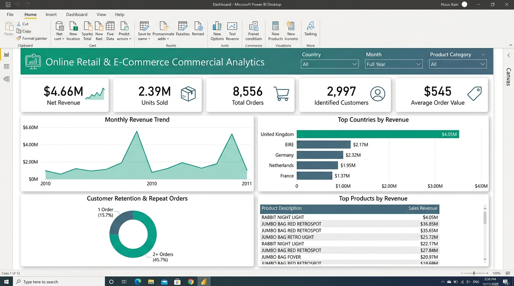

# Online Retail & E-Commerce Transaction Analytics

A reproducible intermediate-level portfolio project using **SQL**, **Python**, and **Power BI** for revenue analysis, product performance, international market breakdown, and **RFM Customer Segmentation**.

---

## 📊 Power BI Dashboard Preview



---

## 📌 Executive Summary & Key Insights

From an analysis of **536,641 deduplicated transactions** (comprising **225,423 valid commercial sales lines**), the commercial pipeline highlights the following metrics:

| Key Performance Indicator | Metric Value | Business Interpretation |
| :--- | :--- | :--- |
| **Total Net Revenue** | **$4,663,255.69** | Excludes cancellations and negative adjustments |
| **Total Units Sold** | **2,388,383 units** | Physical volume moved through fulfillment |
| **Total Orders (Invoices)** | **8,556 orders** | Distinct valid commercial transactions |
| **Identified Customers** | **2,997 customers** | Unique authenticated buyers |
| **Average Order Value (AOV)** | **$545.03** | Mean gross spend per transaction |
| **Cancelled Invoice Lines** | **9,251 lines** | Returns/cancellations isolated from commercial revenue |

### Strategic Findings:
1. **Market Concentration:**
   * **United Kingdom** represents **86.9% ($4.05M)** of all global revenue.
   * Top European expansion markets include **EIRE ($102K)**, **Germany ($94K)**, **Netherlands ($90K)**, and **France ($85K)**.
2. **Seasonality & Q4 Surges:**
   * Sales show consistent demand with dramatic peaks in September, October, and November approaching holiday retail cycles.
3. **Customer Retention & RFM Segmentation:**
   * **Recency, Frequency, and Monetary (RFM)** quartile scoring identified high-value champion customers (Score: `444`) responsible for disproportionate repeat orders, while flagging dormant single-order purchasers for win-back campaigns.

---

## 📂 Project Structure

```text
Ecommerce-Data-Analytics/
├── data/
│   ├── raw/                # Raw source dataset (online_retail.csv)
│   └── processed/          # Cleaned CSVs, monthly sales, RFM, and product tables
├── powerbi/
│   ├── dashboard_preview.png # Power BI dashboard preview image
│   ├── dashboard_spec.md     # Visual design, page layouts, and chart specifications
│   └── measures.dax          # Formatted DAX measures
├── sql/
│   ├── 01_schema.sql         # SQLite-compatible table definitions & indexes
│   └── 02_kpi_analysis.sql   # Sales aggregations, monthly trends, and customer frequency
├── src/
│   └── analyze.py            # Automated end-to-end Python pipeline
├── requirements.txt          # Python dependencies
└── README.md                 # Project documentation
```

---

## 💾 Dataset
Download the public UCI Online Retail dataset mirrored on Kaggle: [Kaggle Online Retail Dataset](https://www.kaggle.com/datasets/carrie1/ecommerce-data).  
Place the CSV at `data/raw/online_retail.csv`. Check license before distributing raw data.

---

## 🚀 How to Run the Pipeline (Python 3.10+)

```bash
# 1. Create and activate a virtual environment
python -m venv .venv
# Windows: .venv\Scripts\activate | macOS/Linux: source .venv/bin/activate

# 2. Install dependencies
pip install -r requirements.txt

# 3. Run data cleaning, RFM segmentation, and summary export
python src/analyze.py --input data/raw/online_retail.csv --output data/processed
```

Outputs include cleaned transactions (`online_retail_clean.csv`), data quality log (`data_quality.csv`), monthly trends (`monthly_sales.csv`), country metrics (`country_summary.csv`), RFM segmentations (`customer_rfm.csv`), and top-selling product tables.

---

## 🗄️ SQL Analytics
`sql/` contains SQLite-compatible queries:
* `sql/01_schema.sql`: Table structure and performance indexes.
* `sql/02_kpi_analysis.sql`: Revenue CTEs, monthly date slicing, top 20 products, and customer order frequency.

---

## 📈 Power BI Setup
1. Open **Power BI Desktop**.
2. Import the cleaned CSV files from `data/processed/`.
3. Add measures from `powerbi/measures.dax`.
4. Follow visual layouts and slicer rules outlined in `powerbi/dashboard_spec.md`.

---

## ⚖️ Definitions & Caveats
Revenue is calculated as `Quantity * UnitPrice`. Cancelled invoices (starting with `'C'`) and non-positive price/quantity anomalies are excluded from net sales and tracked separately.
